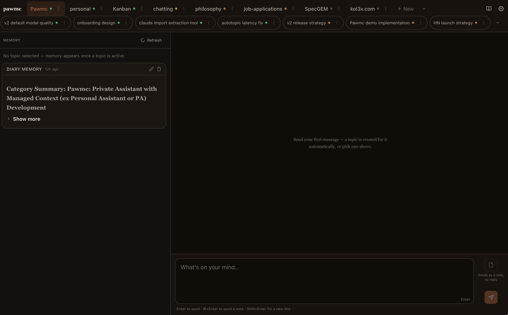

# pawmc: Private Assistant with Managed Context

A personal LLM assistant that runs on Cloudflare Workers and maintains a user-guided compounding knowledge base across conversations. 

When starting a new conversation, choose which historical context you want it to have by choosing a diary and topic. Additional context from new chats is compounded daily or on request.

It's simple and lightweight, and you own your data, pick your model, and control the prompts.

**Try it without deploying:** the [guided demo](https://pawmc-demo.kolaegipet.workers.dev/?demo=1) is a scripted walkthrough of the diary experience — no LLM is running and no data is recorded; it runs on a separate demo instance.

## Related writing

- [Dear LLM, or how I stopped getting generic advice](https://kol3x.com/blog/dear-llm-or-how-i-stopped-getting-generic-advice/) — the story behind pawmc
- [Design before building, or my first finished product](https://kol3x.com/blog/design-before-building-or-my-first-finished-product/) — on development process behind pawmc's latest version
- [Making LLMs not eat my food, or how I picked up TS](https://kol3x.com/blog/making-llms-not-eat-my-food-or-how-i-picked-up-ts/) — on migrating pawmc to TS
- [Development updates on X](https://x.com/kol3xcom) — tiny thoughts as I develop pawmc

## Key advantages

### Compounding context that works

Pawmc asks for a little effort from a user, but the result is predictability of compounding context. Every time you start a chat, you must select a "diary" and "topic" (existing or new) and that's exactly where the context will compound. 

Over time, when you gather context about your fields of interest, you will have multiple context options to use as a background for your new chats. (e.g. "personal", "project-x", "hobby-y", "philosophy")

### Simplicity

It's a great relief to use an LLM that doesn't have search-access and [a system prompt of 200–1500 (!) lines](https://github.com/elder-plinius/CL4R1T4S). Pawmc's system prompt is one short sentence, focused on getting the point across.

### Control over data

You deploy the software, you control the database. The database includes all your conversations and summaries. You can redact your summaries, you can redact your prompts, you can change the model.

In an ideal world, you would also control the LLM deployment, but as of mid-2026 most of us can't host a cutting-edge LLM on a private machine. It's the main tradeoff - prompts are still sent to the companies that host LLMs.

### Cost

Deploying and hosting Pawmc on Cloudflare is way under their free tier limits, and you even get some free daily tokens with Workers AI. 

## Features

- **Diaries and Topics**: Conversations are stored in diaries, organized by topic
- **Automatic Topics**: New chats are auto-sorted into a matching topic, or offered a pick of candidates — no manual filing
- **Context-Aware**: Maintains AI-generated summaries for each diary and topic
- **Notes**: Save a message as pure context — kept for the diary, no AI reply
- **Daily Summaries**: Automatically updates summaries via cron daily
- **API Key Auth**: Secure access with Bearer token authentication
- **Web Interface**: Chat UI with light and dark themes, polished for mobile too

## Setup

Your repository stays linked to the template, so updating to the latest version is a one-click **Sync fork** (see [Getting updates](#getting-updates)). 

### 1. Create your own copy

Click **"Use this template"** on the [GitHub repo](https://github.com/kol3x/Pawmc) to create your own repository.

### 2. Create a Cloudflare account

Go to [dash.cloudflare.com/sign-up](https://dash.cloudflare.com/sign-up) and create a free account. No credit card required.

### 3. Connect your repository to Cloudflare

1. In the Cloudflare dashboard, go to **Workers & Pages** → **Create application** → **Get started** next to **Import a repository**
2. Under **Git account**, select GitHub and authorize it
3. Select your repository and the `main` branch
4. Leave the remaining fields at their defaults, click **Save and Deploy**, and wait for the build to finish (a couple of minutes on the first run)

### 4. Set your API key

1. In the Cloudflare dashboard, open your worker and go to **Settings** → **Variables and Secrets**
2. Add a variable named `API_KEY` with your login password — mark it as a **Secret** so it is stored encrypted (add `OPENROUTER_API_KEY` the same way if you already have an OpenRouter key)
3. The change takes effect on save

### 5. Open your worker

Copy the worker URL from the dashboard (it looks like `https://pawmc.your-subdomain.workers.dev`), open it, enter your `API_KEY`, and start chatting.

## Advanced: Use OpenRouter instead of Workers AI

By default, pawmc uses Cloudflare Workers AI (free, no extra setup). However, Workers AI can be unreliable and is only ok for testing out the project. If you are planning to use it extensively, I recommend switching to [OpenRouter](https://openrouter.ai), which is also supported.

The provider is picked automatically: with an OpenRouter key set, Pawmc uses OpenRouter; without one, it uses Workers AI. 

You'll need to add credit to your OpenRouter account (supports crypto as well). However, it's usually a symbolical spending due to project's simplicity and the budget-friendly model default.

To use it:

1. Create an account at [openrouter.ai](https://openrouter.ai) and generate an API key.
2. Open the Cloudflare dashboard, go to your worker → **Settings → Variables and Secrets**, and add a secret named `OPENROUTER_API_KEY` — the change takes effect on save and survives redeploys. Pawmc switches to OpenRouter automatically whenever the key is set.
3. To use a different model, add `AI_MODEL_OPENROUTER` under `vars` in `wrangler.jsonc` in your repository with any [OpenRouter model slug](https://openrouter.ai/models) and push — it redeploys automatically. (Plain variables set in the dashboard get overwritten by the next build, so the config file is the reliable place.)

To switch back to Workers AI, delete the `OPENROUTER_API_KEY` secret.

## Getting updates

When the template repo is updated, go to your GitHub repo, click **Sync fork** → **Update branch**, and your worker redeploys automatically.

